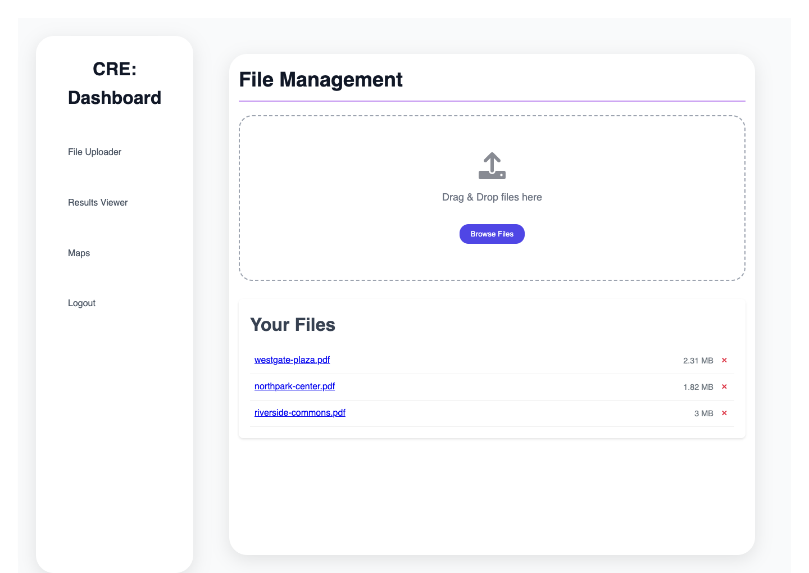
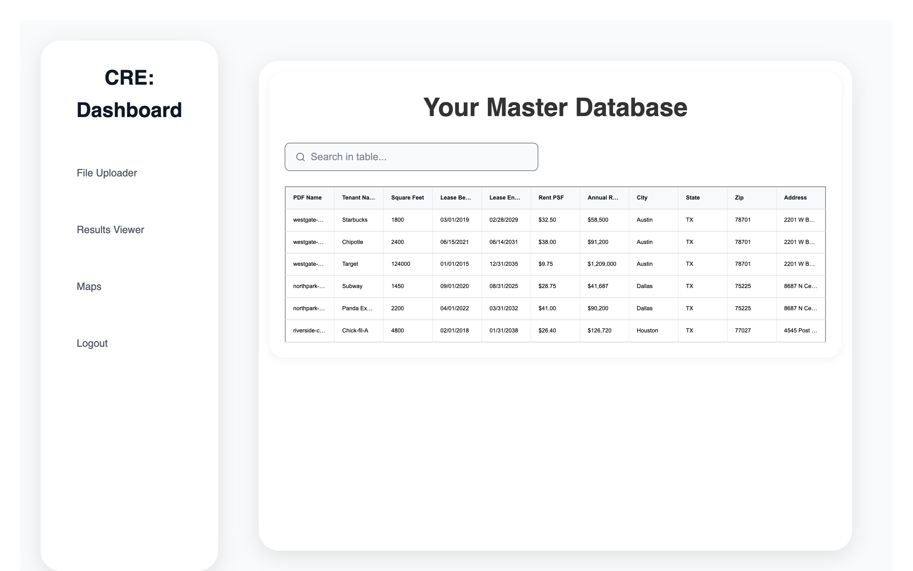
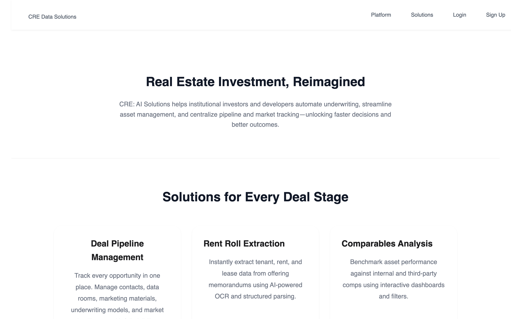
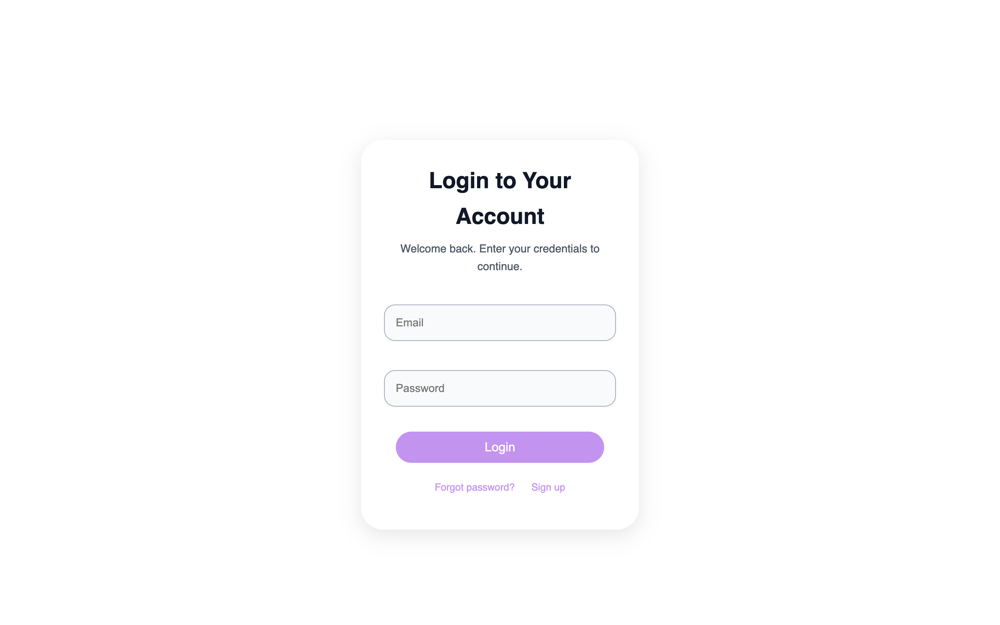

# Rent Roll Tool

**Turn a scanned commercial rent roll PDF into a structured, searchable tenant comparables database.**

Commercial real estate analysts receive rent rolls as PDFs — usually scans or
vector tables that copy-paste into gibberish. Extracting tenant name, square
footage, lease dates and rent for each row is manual work that takes hours per
property and is done again for every deal.

This app does it automatically. Upload a PDF, and an OCR pipeline reads the
table, reconstructs each tenant row, validates the property address against US
postal data, and appends the result to a per-user master workbook that can be
searched, filtered, plotted on a map and exported to Excel.

[](https://github.com/jaycewalzer1/rr-tool2/actions/workflows/ci.yml)
[](https://www.python.org/downloads/)
[](https://github.com/astral-sh/ruff)
[](https://mypy-lang.org/)
[](LICENSE)

---

## Contents

- [Screenshots](#screenshots)
- [How the extraction pipeline works](#how-the-extraction-pipeline-works)
- [Architecture](#architecture)
- [Tech stack](#tech-stack)
- [Running it locally](#running-it-locally)
- [Configuration](#configuration)
- [Testing and quality gates](#testing-and-quality-gates)
- [Deployment](#deployment)
- [Security notes](#security-notes)
- [Project layout](#project-layout)
- [License](#license)

---

## Screenshots

### Upload a rent roll

Drag and drop a PDF. The browser requests a short-lived presigned S3 URL and
uploads directly to the bucket, so the application server never proxies file
bytes. Parsing then runs server-side and appends to the user's workbook.



### Browse the extracted comparables

Every parsed tenant row lands in one master table — tenant, square feet, lease
term, rent PSF, annual rent and the validated property address — searchable
across every PDF the user has ever uploaded.



### Marketing site

<table>
  <tr>
    <td width="50%"></td>
    <td width="50%"></td>
  </tr>
  <tr>
    <td width="50%"></td>
    <td width="50%"></td>
  </tr>
</table>

---

## How the extraction pipeline works

The parsing logic lives in [`tenant_parser/`](tenant_parser/) and is
deliberately separated from the web layer — it takes a PDF path and an Excel
path and has no knowledge of Flask, S3 or the logged-in user.

```
PDF ──▶ page triage ──▶ render 300dpi ──▶ preprocess ──▶ Tesseract ──▶ line
        (text layer)                      (PIL)                        cleanup
                                                                          │
                                                                          ▼
workbook ◀── address validation ◀── field extraction ◀── tenant-name splitting
(openpyxl)      (GeoNames US.txt)     (sq ft, dates, rent)
```

**1. Page triage.** `pymupdf` reads the embedded text layer first — not to
extract data, but to decide which pages contain a rent roll and to locate the
property address. Rendering every page of a 200-page offering memorandum at
300 dpi would be far slower than reading its text layer.

**2. Render and preprocess.** Relevant pages are rasterised at **300 dpi**, the
lowest resolution at which Tesseract reliably keeps the narrow rent columns
apart (below that, `$24.00` merges into the neighbouring cell). Each bitmap is
converted to greyscale, sharpened and contrast-boosted 2× before OCR.

**3. OCR.** Tesseract runs with `--psm 6 --oem 3` — treat the page as one
uniform block of text, using the LSTM engine. PSM 6 is what keeps a table row
on a single output line.

**4. Line cleanup and row splitting.** OCR returns headers, footnotes and
marketing prose alongside the table. Lines without a dollar amount are dropped
outright (every genuine tenant row quotes a rent), as are recognised note and
sentence patterns. What survives is then **split on known tenant names**,
because OCR routinely runs three table rows together into one line. The name
lists — 874 national retailers and 151 anchor tenants — live in
[`tenant_parser/constants.py`](tenant_parser/constants.py).

**5. Field extraction.** For each tenant segment
([`tenant_parser/fields.py`](tenant_parser/fields.py)):

| Field | How it is recovered |
| --- | --- |
| Square feet | Digits in the 800–250,000 range, reassembled from tokens OCR split on a thousands separator (`12 500` → `12500`) |
| Rent PSF | First dollar amount above a plausibility floor — `$4.20` for anchors, `$4.60` for inline tenants — which rejects footnote markers and CAM figures |
| Annual rent | Dollar amounts above `$10,000`, cross-checked against sq ft × PSF |
| Lease dates | Explicit dates where present; otherwise inferred from the stated term using 3/5/10-year heuristics |

**6. Address validation.** The address found in the text layer is checked
against the GeoNames US postal-code export (41,483 ZIP/city/state rows, cached
for the process lifetime) so a misread ZIP does not silently place a Texas
property in Maine. See
[`tenant_parser/addresses.py`](tenant_parser/addresses.py).

**7. Workbook output.** Rows are appended to a `Retail Tenants` sheet and
summarised on a `Summary 1` sheet
([`tenant_parser/workbook.py`](tenant_parser/workbook.py)).

> **A note on openpyxl:** both `sheet.cell()` and `sheet.iter_rows()`
> materialise cells and advance the sheet's internal row cursor, which silently
> shifts every subsequent `append()`. The workbook module writes by explicit
> row index for exactly this reason.

---

## Architecture

```
                    ┌──────────────┐
   browser ────────▶│    Flask     │
      │             │ app factory  │
      │             └──────┬───────┘
      │                    │
      │      ┌─────────────┼─────────────┬──────────────┐
      │      ▼             ▼             ▼              ▼
      │  marketing_     auth_        dashboard_     billing_
      │   routes       routes         routes         routes
      │      │             │             │              │
      │      │             ▼             ▼              ▼
      │      │        Cognito         storage.py     Stripe
      │      │        (boto3)         (S3 keys)     (checkout,
      │      │                            │          webhooks)
      │      │                            ▼
      │      │                        pipeline.py
      │      │                            │
      │      │                            ▼
      │      │                     tenant_parser/
      │      │                    (OCR + parsing)
      │      │
      └──────┴──▶ presigned PUT ──▶ S3 (uploads/<user_id>/)
```

Design decisions worth calling out:

- **Application factory.** `create_app()` builds the app from a validated
  `Config` object ([`config.py`](config.py)). Missing required environment
  variables raise at start-up rather than at first request, so a misconfigured
  container fails its health check instead of serving 500s.
- **One place derives S3 keys.** [`storage.py`](storage.py) owns the
  `uploads/<user_id>/…` convention. Tenant isolation is therefore a single
  auditable function rather than a string concatenation repeated in every view.
- **Uploads bypass the app server.** The browser asks for a presigned PUT URL
  and uploads straight to S3. A 200 MB scan never occupies a gunicorn worker.
- **Subscription state is read from Stripe, not mirrored.** The webhook only
  keeps customer metadata in step; entitlement checks query Stripe. There is no
  local copy to drift out of sync.
- **Parsing is decoupled from the web layer.** `tenant_parser` is importable and
  testable on its own, which is why the field-extraction tests need no Flask
  context.

---

## Tech stack

| Layer | Choice |
| --- | --- |
| Web framework | Flask 3 (app factory + blueprints), Jinja2, Flask-WTF |
| Auth | AWS Cognito via boto3 (hosted user pool, refresh-token rotation) |
| Storage | AWS S3 — presigned PUT/GET, per-user key prefixes |
| Database | SQLAlchemy 2.0 typed declarative models, Flask-SQLAlchemy 3.1 |
| Payments | Stripe Checkout + signature-verified webhooks |
| OCR | PyMuPDF (render) → Pillow (preprocess) → Tesseract via pytesseract |
| Data | pandas, openpyxl, GeoNames US postal reference |
| Quality | ruff (lint + format), mypy (strict), pytest + coverage, pre-commit |
| Runtime | gunicorn in a non-root Python 3.12 slim container |
| CI/CD | GitHub Actions → ECR → EC2 |

---

## Running it locally

**Prerequisites:** Python 3.12 and Tesseract
(`brew install tesseract` / `apt install tesseract-ocr`).

```bash
git clone https://github.com/jaycewalzer1/rr-tool2.git
cd rr-tool2

make install          # create .venv, install deps, install pre-commit hooks
cp .env.example .env  # then fill in the values (see below)
make run              # http://127.0.0.1:5000
```

`make help` lists every target:

| Target | Does |
| --- | --- |
| `make install` | Create the virtualenv, install runtime + dev deps, install hooks |
| `make run` | Development server on port 5000 |
| `make lint` | `ruff check` + `ruff format --check` |
| `make format` | Apply formatting and auto-fixes |
| `make typecheck` | `mypy` |
| `make test` | `pytest` with coverage |
| `make check` | Everything CI runs |
| `make docker` | Build the production image |

Or with Docker:

```bash
make docker
docker run --rm -p 5000:5000 --env-file .env rent-roll-tool:local
```

### Running without AWS or Stripe

Set `FLASK_ENV=testing` and the config layer substitutes dummy values for every
required secret. The marketing pages, forms and templates render; anything that
actually calls Cognito, S3 or Stripe will not. This is the mode the test suite
uses.

---

## Configuration

Every variable is documented in [`.env.example`](.env.example). Required in
production:

| Variable | Purpose |
| --- | --- |
| `SECRET_KEY` | Signs the session cookie |
| `DATABASE_URL` | SQLAlchemy connection string |
| `APP_BASE_URL` | Absolute URLs for Stripe redirects |
| `AWS_REGION`, `COGNITO_USER_POOL_ID`, `COGNITO_APP_CLIENT_ID`, `COGNITO_APP_CLIENT_SECRET` | Authentication |
| `S3_BUCKET_NAME_PDF`, `S3_BUCKET_NAME_EXCEL` | Uploaded PDFs and generated workbooks |
| `STRIPE_SECRET_KEY`, `STRIPE_PUBLIC_KEY`, `STRIPE_WEBHOOK_SECRET`, `STRIPE_PRICE_ID_BASIC` | Subscriptions |
| `GOOGLE_MAPS_API_KEY` | Optional — the map page degrades gracefully without it |

In production, AWS credentials come from the EC2 instance role;
`AWS_ACCESS_KEY_ID` / `AWS_SECRET_ACCESS_KEY` only need setting for local runs.

---

## Testing and quality gates

```
112 passed
TOTAL  1950 stmts   77% coverage
```

```bash
make check    # ruff + ruff format --check + mypy + pytest --cov
```

`mypy` runs with `disallow_untyped_defs`, `disallow_incomplete_defs`,
`no_implicit_optional`, `check_untyped_defs` and `warn_unused_ignores`, and
reports clean across all 25 source modules.

The suite is organised by concern rather than by file:

| File | Covers |
| --- | --- |
| `tests/test_fields.py` | Square footage, rent, date and PSF extraction against realistic OCR output |
| `tests/test_lines.py` | Noise rejection and splitting run-together tenant rows |
| `tests/test_workbook.py` | Sheet construction, row indexing, summary maths |
| `tests/test_pipeline.py` | Download → parse → upload orchestration, including failure paths |
| `tests/test_routes.py` | Blueprint wiring, redirects, JSON contracts |
| `tests/test_security.py` | Path-traversal in filenames, auth gates, tenant isolation on S3 keys, webhook signature enforcement, session hygiene |

[`.github/workflows/ci.yml`](.github/workflows/ci.yml) runs lint, format check,
type check and tests on every push and pull request. The deploy workflow calls
it as a reusable workflow, so nothing reaches EC2 unless all four pass.

---

## Deployment

`.github/workflows/main.yml` on push to `main`:

1. Run the full CI workflow (lint, format, types, tests) — a hard gate.
2. Build the image and push to Amazon ECR.
3. SSH to EC2, pull, replace the running container, and verify it is up —
   dumping container logs and failing the job if it is not.

The image runs gunicorn as an unprivileged user with a `/healthz` healthcheck
and a 300-second worker timeout, since a single OCR request can legitimately
occupy a worker for minutes.

---

## Security notes

- **Webhook signatures are verified.** `stripe.Webhook.construct_event` checks
  every payload against `STRIPE_WEBHOOK_SECRET`. Without it, anyone could POST
  a forged `customer.subscription.created` and grant themselves a paid plan.
- **Accounts are created after payment.** The Cognito user is provisioned in the
  Stripe success handler, so an abandoned checkout never leaves a
  half-provisioned user in the pool.
- **Tenant isolation is centralised.** Every S3 key is built by `storage.py`
  from the session's `user_id`; a request cannot address another user's prefix
  by manipulating a filename.
- **Presigned URLs are short-lived** and scoped to a single object key.
- **CSRF protection** via Flask-WTF on every HTML form post.
- **Uploaded filenames are sanitised** — directory traversal attempts are
  stripped and length is capped before a key is built.
- **Passwords are never written to the session**, including during the
  multi-step signup and confirmation flow. There is a test asserting this.
- **`ProxyFix`** is applied so the app reads the real client IP and scheme from
  the load balancer rather than trusting spoofable headers directly.
- **Secrets never enter the repo.** `.env`, `*.pem`, and sample rent rolls
  (`*.pdf`, `*.xlsx` — real customer data) are git-ignored.

---

## Project layout

```
.
├── app.py                  Application factory, error handlers, request logging
├── config.py               Environment parsing and validation
├── wsgi.py                 gunicorn entry point
├── auth.py                 Cognito client (sign-up, login, token refresh)
├── decorators.py           @login_required, @verify_account
├── storage.py              S3 access; sole owner of key derivation
├── pipeline.py             Download → parse → upload orchestration
├── models.py               Typed SQLAlchemy declarative models
├── forms.py                WTForms definitions
├── routes/
│   ├── marketing_routes.py Public pages, /healthz, favicon
│   ├── auth_routes.py      Signup, confirmation, login, password reset
│   ├── dashboard_routes.py Upload, file list, database view, map, export
│   └── billing_routes.py   Checkout, subscription management, webhooks
├── tenant_parser/
│   ├── ocr.py              Page triage, rendering, preprocessing, Tesseract
│   ├── lines.py            Noise rejection and tenant-row splitting
│   ├── fields.py           Square feet, rent, dates, PSF extraction
│   ├── addresses.py        Address parsing and validation
│   ├── reference.py        Cached GeoNames US postal lookup
│   ├── workbook.py         Data sheet and summary sheet construction
│   ├── exporter.py         Public entry point
│   └── constants.py        Tenant name lists, month abbreviations
├── tests/                  112 tests
└── docs/images/            README screenshots
```

---

## License

[MIT](LICENSE)
